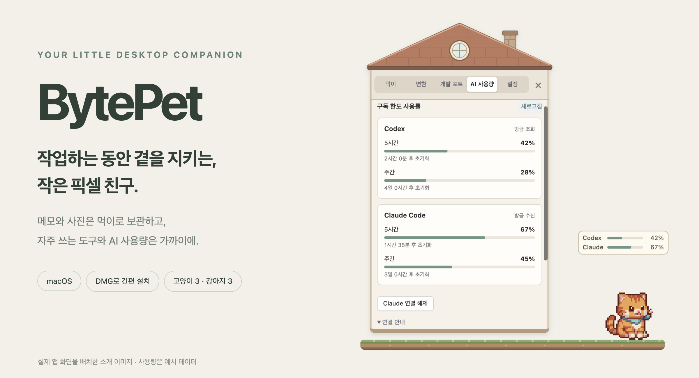
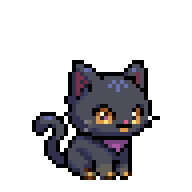
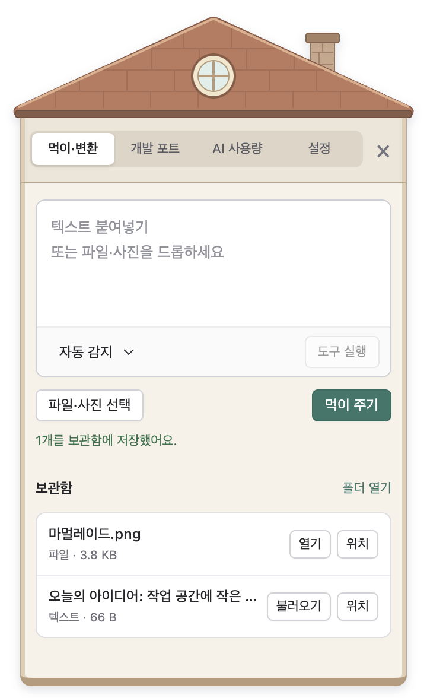
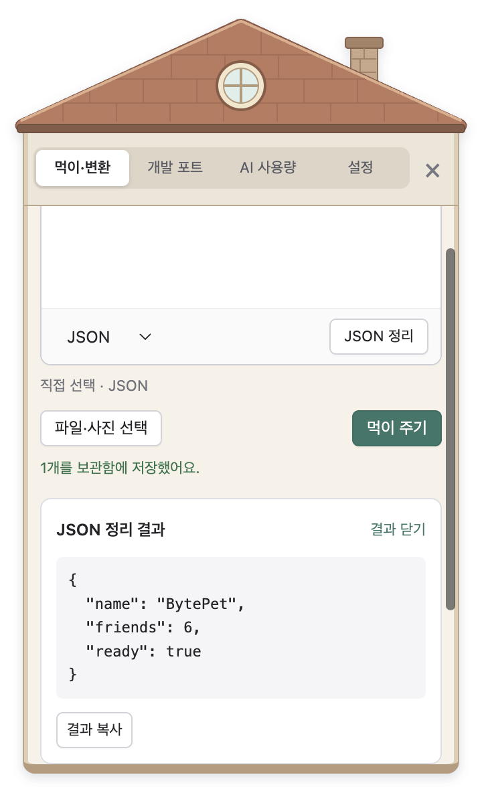
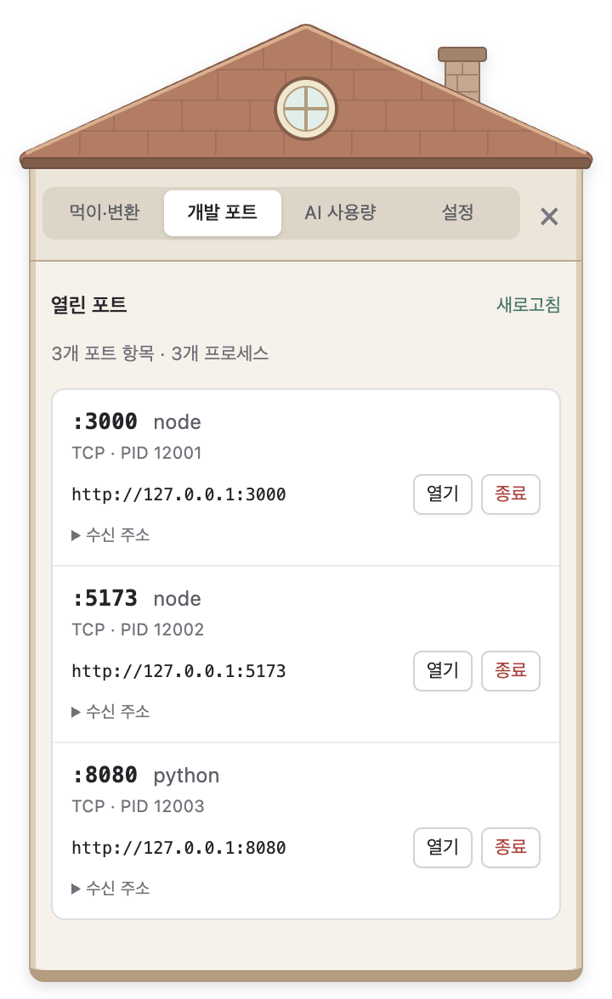
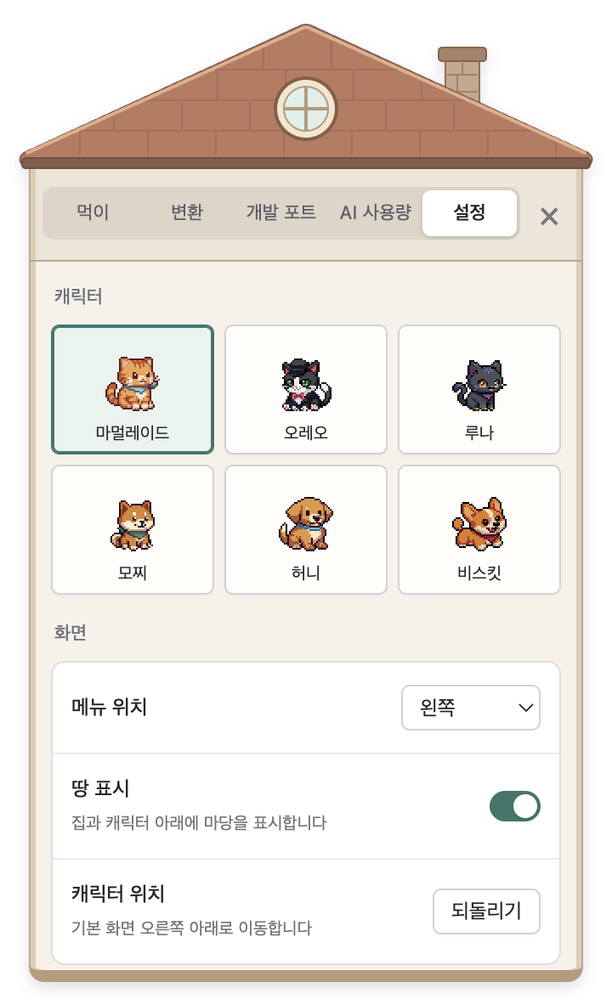
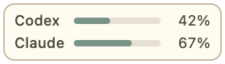

<h1 align="center">BytePet</h1>

> [!IMPORTANT]
> **현재 BytePet은 개발 중인 Preview 버전입니다.** 아직 정식 버전이 아니며, 기능과 UI가 변경되거나 예상치 못한 문제가 발생할 수 있습니다. 버그와 개선 의견은 [GitHub Issues](https://github.com/Sidepond/BytePet/issues)에 남겨 주세요.

<p align="center">
  <strong>작업하는 동안 곁을 지키는, 작은 픽셀 친구.</strong><br>
  macOS를 위한 데스크톱 펫 · 로컬 보관함 · 개발 도구 · AI 사용량
</p>

<p align="center">
  <a href="#설치하기"><strong>DMG 설치</strong></a> ·
  <a href="#캐릭터">캐릭터</a> ·
  <a href="#주요-기능">기능 둘러보기</a> ·
  <a href="#ai-사용량">AI 사용량 연결</a> ·
  <a href="docs/development.md">개발 안내</a>
</p>

<p align="center">
  
</p>

BytePet은 바탕화면에 작은 친구와 자주 쓰는 도구를 함께 놓아줍니다. 메모와 사진을 먹이로 보관하고, JSON을 정리하고, 개발 서버의 포트와 AI 사용량을 가까이에서 확인하세요.

**DMG로 설치하면 바로 시작할 수 있습니다.** 기본 앱 사용에는 터미널, Node.js, API 키가 필요하지 않습니다.

## 설치하기

1. [GitHub Releases](https://github.com/Sidepond/BytePet/releases)에서 사용할 버전의 **Assets**를 펼칩니다.
2. 자신의 Mac에 맞는 `.dmg` 파일을 내려받습니다. `Source code`는 설치 파일이 아닙니다.
3. DMG를 열고 **BytePet Tauri Preview.app**을 **응용 프로그램(Applications)** 폴더로 옮깁니다.
4. 응용 프로그램 폴더에서 **BytePet Tauri Preview**를 실행합니다.

현재 지원 대상은 **macOS**입니다. 제공되는 빌드와 지원 macOS 버전은 각 릴리스 설명을 확인해 주세요. 파일명이 아키텍처별로 나뉘어 있다면 Apple Silicon(M 시리즈)은 `arm64`, Intel Mac은 `x64`를 선택합니다.

0.2 버전부터 Tauri 기반으로 실행합니다. 구버전 Electron 앱의 보관함과 설정은 [데이터 가져오기 안내](docs/tauri-migration.md#저장-데이터와-기존-데이터-가져오기)를 통해 옮길 수 있습니다.

업데이트할 때는 BytePet을 종료하고 새 버전의 앱으로 교체하세요. 보관함과 설정은 앱과 별도 위치에 저장됩니다. Claude Code를 연결했다면 앱을 같은 경로에 유지해 주세요.


## 캐릭터

**고양이 셋, 강아지 셋.** 집 메뉴의 **설정 → 캐릭터**에서 마음에 드는 친구를 선택하세요.

<table>
  <tr>
    <td align="center" width="33%"><br><strong>마멀레이드</strong><br>치즈 고양이</td>
    <td align="center" width="33%"><br><strong>오레오</strong><br>턱시도 고양이</td>
    <td align="center" width="33%"><br><strong>루나</strong><br>까망 고양이</td>
  </tr>
  <tr>
    <td align="center"><br><strong>모찌</strong><br>시바</td>
    <td align="center"><br><strong>허니</strong><br>리트리버</td>
    <td align="center"><br><strong>비스킷</strong><br>코기</td>
  </tr>
</table>

### 쉬고, 먹고, 잠들고

놓아둔 자리에서 쉬다가 잠이 들고, 먹이를 저장하면 냠냠 먹습니다. 고양이를 끌어 옮기면 공중에 들린 자세를 보여줍니다.

<table>
  <tr>
    <td align="center" width="25%"><br><strong>대기</strong></td>
    <td align="center" width="25%"><br><strong>잠자기</strong></td>
    <td align="center" width="25%"><br><strong>먹기</strong></td>
    <td align="center" width="25%"><br><strong>들기</strong></td>
  </tr>
</table>

<sub>앱에 사용되는 실제 프레임과 재생 시간으로 만든 GIF입니다. 대기·잠자기·먹기는 6종 모두 지원하며, 강아지 3종의 전용 들기 모션은 추후 추가할 예정입니다. 앱은 macOS의 동작 줄이기 설정을 따릅니다.</sub>

## 주요 기능

캐릭터를 클릭하면 집 모양 메뉴가 열립니다. **먹이 · 변환 · 개발 포트 · AI 사용량 · 설정**을 오가도 창 크기는 유지되며, 먹이와 변환 입력은 각각 보존됩니다. 스크린샷을 클릭하면 큰 이미지로 볼 수 있습니다.

<table>
  <tr>
    <td align="center" valign="top" width="50%">
      <h3>먹이로 보관하는 메모와 사진</h3>
      <p>텍스트를 입력하거나 파일을 드롭하세요.<br>접히는 밥그릇과 사진 썸네일,<br>검색·필터로 편하게 꺼내세요.</p>
      <a href="docs/images/food-shelf.png"></a>
    </td>
    <td align="center" valign="top" width="50%">
      <h3>가까이 두는 JSON·JWT 도구</h3>
      <p>붙여넣고 실행하면 읽기 좋은 결과로.<br>형식 감지, 오류 위치 확인, 결과 복사까지.</p>
      <a href="docs/images/json-tool.png"></a>
    </td>
  </tr>
  <tr>
    <td align="center" valign="top">
      <h3>개발 포트를 한눈에</h3>
      <p>열린 포트와 프로세스를 확인하고,<br>브라우저로 열거나 종료를 요청하세요.</p>
      <a href="docs/images/dev-ports.png"></a>
    </td>
    <td align="center" valign="top">
      <h3>내 작업 공간에 맞게</h3>
      <p>캐릭터, 메뉴 방향, 땅 표시를 선택하고<br>필요한 기능만 켜두세요.</p>
      <a href="docs/images/settings.png"></a>
    </td>
  </tr>
</table>

<sub>현재 앱에서 예시 데이터로 촬영한 화면입니다. 포트·PID와 AI 사용률은 실제 사용자 정보가 아닌 데모 값입니다.</sub>

<details>
<summary><strong>저장 한도와 도구 동작 자세히 보기</strong></summary>

- **먹이 보관함:** 텍스트 1MB, 파일 개당 25MB, 한 번에 파일 10개까지. 원본 파일을 그대로 두고 복사하며, 폴더·심볼릭 링크는 지원하지 않습니다. 클립보드 이미지도 붙여넣을 수 있습니다.
- **다시 꺼내기:** 보관함의 아이콘을 선택하면 미리보기와 불러오기·열기 버튼이 나타납니다. 저장 위치는 우클릭이나 **··· → 폴더에서 보기**로 확인합니다. 더블클릭이나 `Enter`로 열고, 방향키로 항목을 이동할 수 있습니다. 텍스트는 **변환으로 보내기**로 JSON·JWT 도구에 전달할 수 있습니다. 저장한 먹이는 재실행해도 유지됩니다.
- **빠르게 찾기:** `⌘F`로 이름·메모 본문을 검색하고, 전체·메모·사진·파일 필터로 좁혀 보세요. 일반 파일의 내부 내용은 검색하지 않습니다. 사진은 썸네일, 메모는 본문 일부가 아이콘에 표시됩니다.
- **미리보기:** 항목을 선택하고 `Space` 또는 **미리보기**를 누르면 사진·메모를 확인합니다. 작성 중인 먹이는 그대로 유지되며 `Esc`로 미리보기만 닫습니다. 미리보기를 지원하지 않는 파일은 **열기**로 기본 앱에서 확인하세요. [미리보기 화면 보기](docs/images/food-preview.png)
- **정리하기:** 우클릭이나 **···**에서 보관함에 표시할 이름을 바꾸거나 **휴지통으로 이동**할 수 있습니다. 이름 변경은 원본 파일명·내용에 영향을 주지 않습니다. 휴지통은 앱 내부에 보관되며 **휴지통 → 복원**으로 되돌릴 수 있습니다.
- **JSON:** 큰 정수와 원문의 키 순서를 유지합니다. 문법 오류의 줄·열을 확인하고 해당 위치로 이동할 수 있습니다.
- **JWT:** Header·Payload와 만료 정보를 확인합니다. **서명 검증은 수행하지 않습니다.**
- **로컬 변환:** JSON·JWT를 외부로 전송하거나 자동 저장하지 않습니다. 입력 원문을 보관하려면 **먹이로 보내기 → 먹이 주기**를 누릅니다.
- **포트:** TCP 리스닝 포트를 조회합니다. HTTP 주소로 열기 때문에 웹 서버가 아닌 포트는 브라우저에 페이지가 표시되지 않을 수 있습니다.
- **프로세스 종료:** 확인 창을 거쳐 현재 사용자 소유의 프로세스에 종료를 요청합니다. **포트 하나가 아닌 프로세스 전체에 적용**되며, 자동 강제 종료는 하지 않습니다.

</details>

## AI 사용량

**작은 게이지는 항상 곁에, 자세한 사용량은 클릭 한 번으로.**

<p align="center">
  <br>
  
</p>

Codex와 Claude Code의 **구독 한도 사용률**과 초기화까지 남은 시간을 보여줍니다. API 비용이나 누적 토큰 수를 나타내지는 않습니다. 게이지는 기본적으로 **캐릭터 발밑의 땅에 겹쳐 항상 표시**됩니다. 땅을 숨겨도 발밑에 남으며, 잠자기·먹기 동작을 따라 위아래로 흔들리지 않습니다.

[집 메뉴의 상세 사용량 화면 보기 →](docs/images/ai-usage-panel.png)

AI 사용량은 **선택 기능**입니다. 사용하려는 서비스의 설치와 로그인이 필요하며, 연결하지 않아도 캐릭터와 다른 도구는 사용할 수 있습니다. 위 사용률은 예시입니다.

<details>
<summary><strong>Codex 연결 방법</strong></summary>

1. Mac에 **Codex CLI**를 설치하고 **ChatGPT 계정으로 로그인**합니다.
2. BytePet의 **AI 사용량** 화면을 엽니다.
3. 자동 조회 결과를 확인하거나 **새로고침**을 누릅니다.

BytePet은 설치된 CLI의 계정 연결을 사용합니다. 시작 시와 5분마다 조회하며 수동 새로고침은 30초 간격으로 할 수 있습니다. 조회 과정에서 대화나 모델 추론 요청을 만들지 않습니다. API 키 로그인은 이 구독 사용량 기능의 대상이 아닙니다.


</details>

<details>
<summary><strong>Claude Code 연결 방법</strong></summary>

1. BytePet을 **응용 프로그램** 폴더에 설치한 상태에서 **AI 사용량 → Claude 연결**을 누릅니다.
2. Pro·Max 구독 계정으로 로그인한 **Claude Code**에서 대화를 진행해 응답을 받습니다.
3. Claude Code가 전달한 사용량이 BytePet에 표시되는지 확인합니다.

연결 시 Claude Code의 사용자 설정에 **상태줄 연동**을 추가합니다. 기존 상태줄 출력은 유지하고, 연결 해제 시 이전 설정을 복원합니다. 연결 후 다른 도구가 상태줄 설정을 변경했다면 그 변경을 덮어쓰지 않습니다.

Claude 사용량은 상태줄에서 전달받은 값을 표시하므로, BytePet의 새로고침만으로 새 값을 가져오지는 않습니다. 프로젝트별 상태줄 설정이 우선하는 경우에는 해당 설정도 확인해 주세요. 앱 위치를 바꿨다면 연결을 해제한 뒤 다시 연결합니다.


</details>

<details>
<summary><strong>게이지 위치·표시 설정과 기호 안내</strong></summary>

**설정 → AI 사용량 배지**에서 표시·숨기기, 위치(땅 위·위·왼쪽·오른쪽), 단기·주간 구간, 표시할 서비스를 선택합니다. 서비스를 끄면 해당 사용량 수집도 중지합니다.

| 표시 | 의미 |
| --- | --- |
| 사용률(%) | 해당 구간에서 이미 사용한 한도의 비율입니다. |
| `—` | 해당 한도 데이터가 없거나, 초기화 이후 아직 새 값을 받지 못했습니다. |
| 흐린 게이지와 `*` | 15분 이상 지났거나 조회에 실패한 **이전 확인 값**입니다. |

계정에서 제공하는 한도에 따라 단기·주간 중 일부만 표시될 수 있습니다. 기본 배치는 땅의 높이에 고정되어 잠자기나 먹기 동작을 따라 흔들리지 않습니다.


</details>

## 처음 사용하기

| 하고 싶은 일 | 방법 |
| --- | --- |
| 메뉴 열기·닫기 | 캐릭터를 클릭합니다. 닫을 때는 `Esc`나 메뉴의 닫기 버튼도 사용할 수 있습니다. |
| 위치 옮기기 | 캐릭터나 땅을 잡아 끕니다. 마지막 위치는 다음 실행 때 복원됩니다. |
| 캐릭터 바꾸기 | 집 메뉴의 **설정 → 캐릭터**에서 선택합니다. |
| 설정 바로 열기 | 메뉴바의 고양이 아이콘에서 **설정…**을 선택합니다. 앱이 활성화된 상태에서는 `⌘,`도 사용할 수 있습니다. |
| 캐릭터 위치 되돌리기 | 메뉴바의 **기본 위치로 되돌리기**, 또는 **설정 → 화면 → 캐릭터 위치 → 되돌리기**를 누릅니다. |
| JSON·JWT 변환 | **변환**에 붙여넣고 실행합니다. 형식을 자동으로 감지하거나 직접 선택할 수 있습니다. |
| 텍스트 보관하기 | **먹이 → 메모 남기기 · 파일 넣기**를 펼쳐 입력한 뒤 **먹이 주기**를 누릅니다. 저장하면 입력칸이 접힙니다. |
| 보관함 검색·미리보기 | `⌘F`로 검색하고, 아이콘 선택 후 `Space`로 미리보기합니다. |
| 사진·파일 보관하기 | 캐릭터나 먹이 화면에 파일을 드롭하거나, 밥그릇을 펼쳐 **파일·사진 선택**을 누릅니다. |
| 이름 변경·삭제·복원 | 아이콘을 우클릭하거나 **···**를 누릅니다. 휴지통으로 옮긴 항목은 **휴지통** 필터에서 선택해 **복원**합니다. |
| 잠시 숨기기 | macOS 메뉴바의 고양이 아이콘에서 **잠시 숨기기**를 선택합니다. **다시 표시**로 돌아옵니다. |
| 앱 종료하기 | 메뉴바에서 종료하거나, 캐릭터를 우클릭해 **BytePet 종료**를 선택합니다. |

캐릭터는 놓아둔 자리에서 쉬거나 잠을 잡니다. 바탕화면을 자동으로 돌아다니지는 않습니다. 투명한 여백은 뒤쪽 앱을 그대로 클릭할 수 있고, 가상 데스크톱(Space)을 바꾸거나 전체 화면 앱을 사용해도 함께 표시됩니다.

**설정 → 앱**에서 **로그인 시 자동 실행**을 켜면 Mac 로그인과 함께 시작할 수 있습니다. 앱을 계속 사용할 위치에 둔 뒤 설정해 주세요. macOS 승인이 필요한 경우 화면에 안내하며, 개발 실행에서는 이 옵션을 사용할 수 없습니다.

같은 화면에서 현재 버전을 확인하고 **환경 정보 복사**로 버전·운영체제·아키텍처를 복사할 수 있습니다. 업데이트 확인은 아직 지원하지 않습니다. 위치 되돌리기는 기본 모니터로 캐릭터를 가져오며, 캐릭터 선택·입력 내용·보관함은 유지합니다.


## 데이터 보관

**먹이와 설정은 내 Mac에 저장됩니다.** 보관함의 **폴더 열기**로 저장한 파일을 확인할 수 있습니다.

<details>
<summary>저장 위치와 AI 연동 데이터 안내</summary>

먹이와 설정은 Mac의 다음 폴더에 저장됩니다.

```text
~/Library/Application Support/BytePet-Tauri
```

- **텍스트·파일:** `food/`에 보관합니다. 앱의 **폴더 열기**로 접근할 수 있습니다.
- **보관함 휴지통:** 옮긴 자료도 앱의 로컬 데이터에 남아 재실행 후 복원할 수 있습니다. macOS 휴지통과 별개이며 자동으로 비워지지 않습니다.
- **설정:** 캐릭터, 화면 배치, 위치, 기능 및 사용량 표시 설정을 로컬 파일로 저장합니다.
- **JSON·JWT:** 로컬에서 처리하며 자동 저장하거나 외부 서버에 전송하지 않습니다. 입력 원문을 보관하려면 **먹이로 보내기 → 먹이 주기**를 누릅니다.
- **AI 사용량:** Codex는 설치된 CLI를 통해 조회하고, Claude는 로컬 상태줄 연동을 사용합니다. Claude 사용량 캐시에는 사용률·초기화 시각·수신 시각만 기록하며 대화 내용이나 인증 정보를 저장하지 않습니다.

Claude 연결 파일과 이전 상태줄 복원 기록은 Claude 설정 폴더의 `bytepet-tauri-usage/`에 별도로 저장됩니다. 기본 위치는 `~/.claude/bytepet-tauri-usage/`입니다.


</details>

## 자주 묻는 질문

<details>
<summary>개발자가 아니어도 사용할 수 있나요?</summary>

네. 캐릭터를 화면에 두거나 메모·사진 보관함만 사용해도 됩니다. 필요 없는 개발 기능과 AI 사용량 게이지는 설정에서 끌 수 있습니다.

</details>

<details>
<summary>Windows나 Linux에서도 사용할 수 있나요?</summary>

현재는 macOS를 대상으로 제공합니다. Windows·Linux는 검증하지 않았습니다.

</details>

<details>
<summary>여러 데스크톱이나 모니터에서는 어떻게 보이나요?</summary>

캐릭터와 메뉴, 사용량 게이지는 macOS의 가상 데스크톱과 전체 화면 앱에서도 표시됩니다. 여러 모니터에 동시에 복제되지는 않으며, 다른 모니터로 옮기려면 드래그합니다.

</details>

<details>
<summary>캐릭터가 보이지 않아요.</summary>

메뉴바의 고양이 아이콘에서 **다시 표시**를 선택하거나 Dock에서 BytePet을 활성화해 보세요. 게이지만 보이지 않는다면 설정의 **AI 사용량 배지** 표시 여부를 확인해 주세요.

위치를 찾기 어렵다면 메뉴바의 **기본 위치로 되돌리기**를 선택하세요. 숨김 상태에서도 기본 모니터에 다시 표시합니다.

</details>

<details>
<summary>Claude 사용량이 갱신되지 않아요.</summary>

연결 후 Claude Code에서 응답을 받아야 합니다. 프로젝트의 상태줄 설정이 사용자 설정을 덮어쓰는지도 확인해 주세요. Claude Desktop과 Claude Code는 별개이며, 이 기능은 Claude Code에 연결합니다.

</details>

<details>
<summary>실수로 보관함의 자료를 삭제했어요.</summary>

**먹이 → 휴지통** 필터에서 항목을 선택하고 **복원**을 누르세요. 기존 이름과 내용 그대로 보관함으로 돌아옵니다.

</details>

<details>
<summary>앱을 삭제하면 보관함도 지워지나요?</summary>

앱을 휴지통으로 옮겨도 로컬 데이터 폴더는 남습니다. 완전히 삭제하려면 필요한 파일을 백업한 뒤 위 데이터 폴더를 직접 정리하세요. Claude를 연결했다면 앱을 삭제하기 전에 **Claude 연결 해제**를 눌러 상태줄을 복원해 주세요.

</details>

## 피드백과 개발 참여

버그나 제안은 [GitHub Issues](https://github.com/Sidepond/BytePet/issues)에 남겨 주세요. 문제를 재현하는 순서와 함께 BytePet 버전, macOS 버전, Mac 종류(Apple Silicon·Intel)를 알려주시면 도움이 됩니다. 스크린샷이나 로그를 첨부할 때는 개인 파일 내용과 인증 정보를 가려 주세요.

- [개발 환경·빌드·테스트 안내](docs/development.md)
- [Tauri 실행과 기존 데이터 가져오기](docs/tauri-migration.md)
- [기능 구현 현황과 후속 작업](docs/roadmap.md)
- [캐릭터 규격과 생성 기록](art/pixellab-character-pack/README.md)
