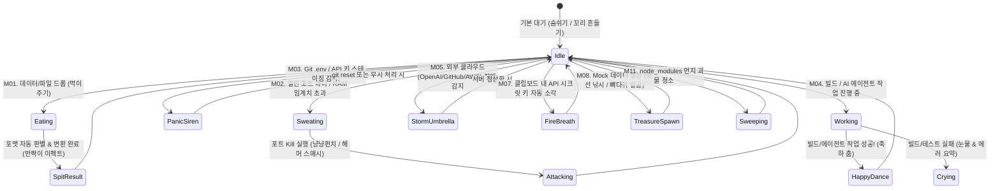
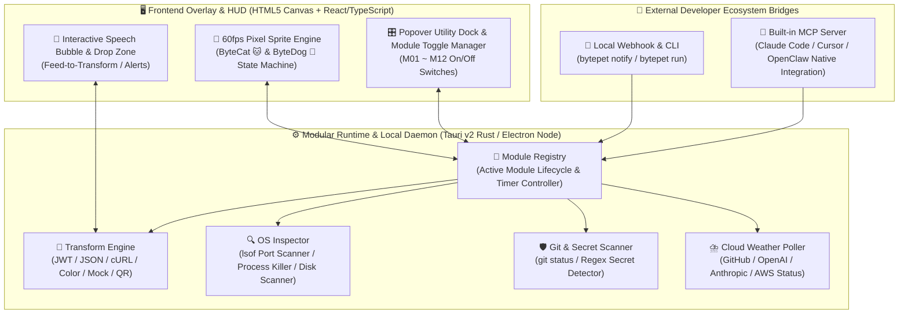

# 🐾 BytePet (바이트펫) — 전체 기획서 및 제품 요구사항 정의서 (PRD)

> **"구경만 하는 다마고치는 끝났다 — 데이터를 먹으면 변환해 뱉어내고, 로컬 포트와 Git 대형사고를 막아주는 살아있는 레트로 픽셀 개발자 펫"**
>
> * **문서 버전:** v1.0.0
> * **프로젝트명:** `BytePet` (바이트펫)
> * **타겟 플랫폼:** macOS / Windows / Linux (투명 데스크톱 오버레이 앱) + Web Playground (설치 전 1초 체험용 웹 데모)
> * **핵심 컨셉:** 레트로 픽셀 아트 캐릭터(**고양이 ByteCat 🐱 & 강아지 ByteDog 🐶**) + **12가지 모듈형 개발자 유틸리티(사용자 선택형 ON/OFF)** + **기능별 캐릭터 액션 인터랙션**

---

## 1. 기획 배경 및 제품 비전 (Executive Summary)

### 1.1 문제 정의 (Problem Statement)
1. **기존 데스크톱/AI 펫의 한계 (장식품의 한계):**
   * 최근 ChatGPT의 Pet 기능 및 오픈소스 생태계의 `AgentPet`, `Clyde`, `OpenPets` 등이 큰 화제를 모았으나, 대부분 **"단순히 화면에서 걸어 다니거나 토큰 사용량으로 경험치(XP)만 올리는 수동적 장식품(Passive Toy)"**에 머물러 있습니다.
   * 실제 개발 업무에 주는 실익이 없다 보니 개발자들이 설치 후 이틀 만에 리소스 낭비로 여겨 종료하게 됩니다.
2. **개발자 일상 도구의 파편화 (Context Switching 피로):**
   * 개발자는 하루에도 수십 번씩 ① JWT 디코딩/JSON 포맷팅을 위해 웹 브라우저 탭을 열고, ② `Port 3000 already in use` 에러를 잡으려 터미널에서 `lsof -i :3000`을 치며, ③ `.env` 파일이 실수로 Git에 올라가는지 확인하고, ④ 외부 API(OpenAI, GitHub, AWS) 장애인지 내 코드 문제인지 확인하느라 흐름(Flow)이 끊깁니다.
   * `DevToys` 같은 올인원 툴이 존재하지만, 별도의 무거운 창을 띄워 메뉴를 찾아 들어가야 하므로 손이 잘 가지 않습니다.

### 1.2 해결책 (The BytePet Solution)
**BytePet**은 항상 화면 구석(또는 메뉴바/독 위)에 떠 있는 **레트로 픽셀 아트 고양이(🐱)와 강아지(🐶)** 캐릭터에 **개발자가 매일 쓰는 12가지 핵심 유틸리티를 캐릭터의 '행동(Action)'과 '먹이 주기(Drag & Drop)'로 결합**한 프로젝트입니다.

* **평소(Passive HUD):** 내 컴퓨터의 열린 포트, Git 상태, 클라우드 서버 날씨(장애 여부), 빌드/AI 에이전트 상태를 **캐릭터의 표정과 날씨/소품 애니메이션**으로 한눈에 보여줍니다.
* **사용 시(Active Utility):** 텍스트나 파일을 **캐릭터 입에 드래그해서 먹이면(Feed)** 냠냠 씹어서 해독·변환·압축해 뱉어내고, 버튼 하나로 좀비 포트를 앞발로 때려잡으며, API 키를 불꽃으로 소각합니다.
* **모듈형 커스터마이징(Modular On/Off):** 12가지 완전체 기능을 제공하되, 사용자가 **원하는 기능만 스위치로 켜고 끌 수 있어** 가볍고 개인화된 환경을 보장합니다.

---

## 2. 시장 분석 및 차별화 포인트 (Competitive Landscape)

| 비교 항목 | 기존 AI 데스크톱 펫 (`AgentPet`, `Clyde`) | 기존 개발자 유틸리티 (`DevToys`, 웹 변환기) | **BytePet (바이트펫)** |
| :--- | :--- | :--- | :--- |
| **핵심 역할** | 단순 애니메이션, 토큰 XP 카운터 | 정적인 변환 도구 모음집 (별도 창 실행) | **살아있는 시스템 HUD + 즉각 반응형 유틸리티 펫** |
| **상호작용 방식** | 구경만 가능 (클릭 시 단순 모션) | 메뉴 검색 → 입력창 복사/붙여넣기 → 결과 복사 | **드래그 앤 드롭("먹이 주기") 1초 자동 판별 & 변환** |
| **시스템 제어** | 없음 (로그 읽기 전용) | 없음 (단순 텍스트/파일 변환만 지원) | **로컬 포트 사살, 모바일 QR 생성, Git 시크릿 감시, 캐시 청소** |
| **캐릭터성** | 단일 고정 캐릭터 | 캐릭터 없음 (일반 유틸리티 UI) | **픽셀 고양이(🐱) & 강아지(🐶) 2종 + 12종 기능별 전용 액션** |
| **커스터마이징** | 불가 | 불가 | **12개 기능 모듈 개별 ON/OFF 및 프리셋 지원** |

> [!TIP]
> **깃허브 스타(Star) 폭발 포인트:**
> README 최상단에 **"고양이 펫 입에 JWT 토큰을 드래그해서 먹이자마자 냠냠 씹어 해독된 JSON 말풍선을 띄우고, 강아지 펫이 망치로 `Port 3000` 좀비 프로세스를 내려쳐서 끄는 5초짜리 GIF"** 한 장만 배치해도 Hacker News(`Show HN`), Reddit(`r/programming`), X(Twitter)에서 즉각적인 바이럴을 일으킬 수 있습니다.

---

## 3. 캐릭터 시스템 및 액션 상태 머신 (Character & Animation Spec)

### 3.1 메인 캐릭터 2종 정의
사용자는 언제든 메인 캐릭터를 **고양이(ByteCat)** 또는 **강아지(ByteDog)**로 전환하거나, 화면에 **두 마리를 동시에 띄워 역할을 분담**(예: 고양이는 변환/보안 담당, 강아지는 포트/빌드 담당)시킬 수 있습니다.

| 구분 | 🐱 **ByteCat (바이트캣 - 고양이)** | 🐶 **ByteDog (바이트독 - 강아지)** |
| :--- | :--- | :--- |
| **컨셉 & 성격** | 도도하고 날카로운 보안·데이터 해독 전문가 | 충직하고 에너지 넘치는 포트 사냥꾼 & 빌드 파수꾼 |
| **기본 외형** | 24×24 레트로 픽셀 치즈/턱시도/까만 고양이 (스킨 변경 가능) | 24×24 레트로 픽셀 시바견/리트리버/웰시코기 (스킨 변경 가능) |
| **특화 모션** | **냥냥펀치**(포트 사살), **하악질 & 털 곤두서기**(시크릿 유출 경보), **황금 생선 낚시**(Mock 데이터 생성), **식빵 굽기**(대기) | **멍멍 해머 스매시**(포트 사살), **사이렌 짖기**(시크릿 유출 경보), **땅 파서 황금 뼈다귀 발굴**(Mock 데이터 생성), **꼬리 프로펠러**(빌드 완료) |

### 3.2 기능-캐릭터 동작(Action) 매핑 매트릭스

모든 유틸리티 기능은 단순한 텍스트 출력이 아니라 **캐릭터의 고유 픽셀 애니메이션과 1:1로 연동**됩니다.



---

## 4. 모듈형 12대 기능 상세 요구사항 (Modular Feature PRD)

### 4.1 모듈 매니저 (Feature Toggle & Preset System)
> [!IMPORTANT]
> **핵심 설계 원칙: "완전체로 제공하되, 선택은 사용자에게"**
> 모든 사용자는 12개 기능 중 본인이 원하는 기능만 체크박스로 켜고 끌 수 있습니다. **꺼진(OFF) 모듈은 백그라운드 감시 타이머(Polling)와 메모리에서도 완전히 언로드(Unload)** 되어 CPU/RAM 점유율을 0%로 유지합니다.

* **원클릭 추천 프리셋(Presets) 제공:**
  1. 🌟 **All-in-One (완전체 모드):** 1~12번 모든 기능 활성화
  2. ⚡ **Minimalist (초경량 모드):** M01(먹이 변환기) + M02(포트 매니저) + M03(Git 파수꾼)만 활성화
  3. 🎨 **Frontend / UI 모드:** M01 + M02 + M06(모바일 QR) + M09(컬러/Tailwind) 활성화
  4. 🤖 **Vibe Coder (AI 에이전트 모드):** M02 + M03 + M04(AI 에이전트 연동) + M05(클라우드 장애 기상청) + M07(시크릿 소각) 활성화

---

### 4.2 개별 모듈 상세 명세 (M01 ~ M12)

#### 🍖 [M01] 먹이 주기 만능 변환기 (Feed-to-Transform)
* **개요:** 텍스트나 파일을 캐릭터에게 드래그 앤 드롭(또는 캐릭터 클릭 후 `Ctrl/Cmd + V`)하면 입력 데이터의 형식을 자동으로 추론하여 즉시 변환·해독합니다.
* **캐릭터 동작:** 드래그한 항목이 캐릭터 근처에 오면 **입을 크게 벌리고(`Open Mouth`)**, 놓으면 **볼이 빵빵해지며 냠냠 씹은 뒤(`Chewing`)**, **별빛과 함께 결과 말풍선을 뱉어냅니다(`Spit Out`).**
* **자동 감지 및 변환 규칙 (Zero-Click Auto-Detect):**
  1. **JWT 토큰 (`eyJ...`):** Header / Payload JSON 디코딩 + `exp`(만료 시각)를 읽어들여 *"만료까지 23분 남음"* 또는 *"⚠️ 2시간 전 만료됨"* 배지 표시.
  2. **JSON / YAML / SQL 문자열:** 문법 오류 위치 진단 + 깔끔한 들여쓰기(Prettify) + JSON의 경우 **TypeScript `interface` 및 Zod 스키마 자동 생성** 탭 제공.
  3. **Unix Timestamp (`1760492300` 등):** 로컬 시간(KST 등), UTC, 상대 시간(*"3시간 전"*)으로 동시 변환.
  4. **Base64 / URL Encoded 문자열:** 즉시 평문 디코딩 (일반 텍스트를 넣고 토글 시 인코딩).
  5. **cURL 명령어:** `fetch` (TS/JS), `axios`, `Python requests` 코드로 즉시 변환.
  6. **이미지 파일 드롭 (`.png`, `.jpg`, `.svg`):** 로컬에서 즉시 용량을 압축한 `.webp` 변환 파일 생성 및 Base64 Data URI 복사 버튼 제공.
  7. **에러 스택트레이스 (Error Log):** 수십 줄의 로그 중 `node_modules` 내부 경로를 흐리게 처리하고, **실제 내 소스 코드에서 터진 파일명:줄번호**만 하이라이트.

---

#### 🔌 [M02] 로컬 포트 & 좀비 프로세스 파수꾼 (Port & Zombie Process Hunter)
* **개요:** 현재 내 PC에서 리스닝 중인 로컬 개발 포트(`3000`, `5173`, `8000`, `8080`, `5432`, `6379` 등)와 각 프로세스의 메모리 사용량을 실시간 감시합니다.
* **캐릭터 동작:**
  * 활성 개발 포트가 5개 이상이거나 특정 프로세스가 RAM 2GB 이상을 점유하면 캐릭터가 **무거운 배낭을 메고 땀을 뻘뻘 흘립니다(💦).**
  * 사용자가 `[💥 Kill]` 버튼을 누르면 **고양이는 냥냥펀치, 강아지는 뿅망치 스매시 애니메이션**과 함께 해당 PID를 즉시 종료(`kill -9`)하고 상쾌한 표정을 짓습니다.
* **세부 기능:**
  * 개발용 주요 포트 필터링 (시스템 기본 데몬 숨김 및 즐겨찾기 포트 고정).
  * 각 포트별 **프로세스 이름(Node, Python, Docker, Postgres), PID, 점유 시간, RAM 사용량** 표시.
  * 원클릭 `[🌐 브라우저 열기]`, `[📱 QR 보기(M06 연동)]`, `[💥 즉시 종료(Kill)]`.

---

#### 😱 [M03] Git 파수꾼 (Git Guardian & Commit Hygiene)
* **개요:** 현재 활성 프로젝트(또는 등록된 워크스페이스 폴더)의 Git 상태를 감시하여 치명적인 시크릿 유출과 커밋 누락을 예방합니다.
* **캐릭터 동작:**
  * **시크릿 감지 시:** `.env` 파일이나 코드 내 `sk-...`, `ghp_...`, `AKIA...`, `PRIVATE KEY` 패턴이 `git add`(Staged) 되는 순간, **고양이는 털이 곤두서며 하악질을 하고, 강아지는 빨간 경광등을 켜고 짖으며** 화면 구석에서 긴급 경고를 보냅니다!
  * **장시간 미커밋 시:** 마지막 커밋 이후 **수정한 코드가 500줄을 넘거나 2시간이 경과**하면 캐릭터가 불안하게 발을 동동 구르며 *"체크포인트 커밋 한 번 할까요?"* 말풍선을 띄웁니다.
* **세부 기능:**
  * 현재 브랜치명 표시 (`main`/`master`에서 직접 수정 중일 때 주황색 주의 배지 표시).
  * Staged 영역 내 정규식 기반 고위험 시크릿 패턴 실시간 스캔 + 원클릭 `[🛡️ Unstage (git reset)]` 버튼 제공.

---

#### 🤖 [M04] AI 에이전트 & 빌드 감시견 + 뽀모도로 (Agent/Build Watchdog & Focus)
* **개요:** Claude Code, Cursor, Codex, OpenClaw 등 AI 코딩 에이전트 및 장기 실행 빌드(`npm`, `cargo`, `docker`, `pytest`)의 상태를 캐릭터와 동기화합니다.
* **캐릭터 동작:**
  * **에이전트/빌드 작업 중:** 캐릭터가 미니 노트북을 두드리거나 안전모를 쓰고 땅을 팝니다(🔨).
  * **승인 대기(Permission Needed):** AI 에이전트가 명령어 실행 승인을 기다릴 때 캐릭터 머리 위에 **`[❓ 승인 필요!]`** 느낌표가 뜨며 통통 쏩니다.
  * **작업 완료 / 성공:** 캐릭터가 폭죽과 함께 **신나는 축하 댄스(🎉)** 를 춥니다.
  * **빌드 / 테스트 실패:** 캐릭터가 머리를 감싸 쥐거나 눈물을 흘리며(😭) 실패한 명령어 요약을 보여줍니다.
* **연동 방식:**
  * 로컬 경량 HTTP 웹훅(`POST http://127.0.0.1:49200/notify`) 및 **MCP (Model Context Protocol) 서버 내장**으로 어떤 에이전트나 터미널 명령어(`bytepet run npm run build`)와도 1초 만에 연동.
  * **집중 뽀모도로 타이머:** 25분 집중 코딩 시 캐릭터도 안경을 쓰고 같이 코딩하며, 휴식 시간(5분)에는 커피를 마십니다.

---

#### ⛈️ [M05] "내 코드 탓이 아니에요!" — 외부 서버 장애 기상청 (Cloud Status Weather)
* **개요:** 내 코드 버그인 줄 알고 1시간 동안 삽질했는데 알고 보니 외부 클라우드/AI 서버 장애였던 상황을 방지합니다.
* **캐릭터 동작:**
  * 평상시(All Operational)에는 캐릭터 주변이 맑은 날씨(☀️)입니다.
  * 감시 대상 서비스 중 하나라도 장애(Outage / Degraded Performance)가 발생하면 **캐릭터 머리 위에 먹구름과 번개(⛈️)가 치고 캐릭터가 노란 우비를 입으며** *"⛈️ 내 코드 탓이 아니에요! 현재 Anthropic API 응답 지연 발생 중!"* 배너를 띄웁니다.
* **기본 감시 대상 (Statuspage JSON API 연동):**
  * GitHub (Git / Actions / Pages), OpenAI API, Anthropic (Claude API), AWS, Vercel, Cloudflare, npm Registry, Supabase.

---

#### 📱 [M06] 로컬호스트(`localhost`) 모바일 QR 포털
* **개요:** PC에서 개발 중인 로컬 웹서버 화면을 스마트폰(동일 와이파이)에서 즉시 테스트할 수 있게 연결합니다.
* **캐릭터 동작:** 포트의 `[📱 QR]` 버튼을 누르면 캐릭터가 **픽셀 아트 스타일의 QR 코드 보드판**을 머리 위로 번쩍 들어 올립니다!
* **세부 기능:**
  * 내 PC의 로컬 네트워크 IP(`192.168.x.x` 또는 `10.x.x.x`) 자동 감지 및 `http://192.168.x.x:포트번호` QR 코드 즉시 생성.
  * 외부 네트워크 공유가 필요할 때 원클릭으로 `cloudflared` / `localtunnel` 임시 터널 URL 생성 및 복사 지원.

---

#### 🫃 [M07] 펫의 위장 (Stomach) — 스마트 클립보드 히스토리 & 시크릿 자동 소각
* **개요:** 최근 복사한 스니펫을 타입별로 자동 분류해 보관하고, 클립보드에 남은 위험한 API 키를 자동으로 마스킹 및 소각합니다.
* **캐릭터 동작:**
  * 클립보드에 API 키나 비밀번호 패턴이 복사되면 캐릭터 배에서 시한폭탄 타이머(예: 180초)가 돌아가고, 시간이 다 되면 **캐릭터가 입에서 불꽃(🔥)을 뿜어 클립보드의 시크릿을 안전하게 태워버립니다(초기화)!**
* **세부 기능:**
  * 최근 N개(기본 20개, 로컬 메모리 전용) 클립보드 히스토리 자동 태깅 (`[JSON]`, `[URL]`, `[Shell]`, `[Color]`, `[Secret]`).
  * **화면 공유 보호 모드:** `Secret`으로 분류된 항목은 UI에서 자동으로 `sk-proj-****...****` 형태로 가려져 Zoom/디스코드 화면 공유 중에도 안전.

---

#### 🥚 [M08] 황금 보물 낳기 — 원클릭 Mock 데이터 자판기
* **개요:** 개발 및 테스트 중 급히 필요한 더미 데이터를 1초 만에 생성해 클립보드에 넣어줍니다.
* **캐릭터 동작:** 버튼을 누르면 **고양이는 낚싯대로 황금 생선을 낚아 올리고(🎣), 강아지는 땅을 파서 황금 뼈다귀를 발굴(🦴)** 하며 데이터를 클립보드에 복사합니다.
* **생성 지원 항목:**
  * `UUID v4` / `UUID v7` / `ULID` / `NanoID`
  * 한국어 & 영어 가짜 프로필 (이름, 이메일, `010-xxxx-xxxx` 전화번호, 도로명 주소)
  * 결제 테스트용 신용카드 번호 (Luhn 알고리즘 유효성 통과 번호)
  * 더미 유저 리스트 JSON 배열 (3명 / 10명분 즉시 복사)

---

#### 🎨 [M09] 카멜레온 스포이드 — 컬러 피커 & Tailwind CSS 변환기
* **개요:** 화면의 특정 픽셀 색상을 추출하거나 색상 코드를 입력하면 프론트엔드 개발에 필요한 모든 색상 포맷과 접근성 점수를 알려줍니다.
* **캐릭터 동작:** 색상을 선택하면 **고양이의 목걸이/스카프 또는 강아지의 두건 색깔이 해당 색상으로 즉시 염색**됩니다!
* **세부 기능:**
  * `HEX` ↔ `RGB` ↔ `HSL` ↔ `OKLCH` 양방향 즉시 변환.
  * **Tailwind CSS 근사치 매칭:** 입력한 색상과 가장 가까운 Tailwind 클래스명(예: `#3B82F6` → `blue-500`, 오차율 표시) 자동 추천.
  * 흰색/검은색 텍스트 대비 **WCAG 명도 대비(Contrast Ratio: AA / AAA 통과 여부)** 즉시 계산.

---

#### ⚔️ [M10] 포켓몬 기술 슬롯 (Quick Command Slots 1~4)
* **개요:** 매일 반복해서 치는 터미널 명령어 4개를 RPG 게임의 기술 슬롯처럼 등록해 두고 마우스 클릭 한 번으로 실행합니다.
* **캐릭터 동작:** 슬롯 클릭 시 **레트로 RPG 배틀 이펙트(⚡ 번개 / 🔥 화염 / 💧 물대포)** 가 터지면서 백그라운드에서 해당 쉘 명령어를 실행하고 성공/실패 결과를 말풍선으로 알려줍니다.
* **기본 예시 슬롯 (사용자 수정 가능):**
  * `기술 1: 도커 기동` (`docker compose up -d`)
  * `기술 2: 포트 청소` (`npx kill-port 3000 5173 8080`)
  * `기술 3: Git 소프트 취소` (`git reset --soft HEAD~1`)
  * `기술 4: DNS/캐시 플러시` (`dscacheutil -flushcache`)

---

#### 🧹 [M11] 먼지 괴물 사냥 — `node_modules` & 빌드 캐시 청소기
* **개요:** 지정한 개발 폴더(`~/Projects` 등) 하위에 방치된 거대 캐시 폴더들을 찾아내어 디스크 용량을 회수합니다.
* **캐릭터 동작:** 스캔 시작 시 캐릭터가 탐정 돋보기를 들고 먼지 괴물(Dust Monster)을 찾아내며, `[🧹 청소하기]` 클릭 시 **빗자루를 휘둘러 먼지 괴물을 쓸어버리고 확보한 용량(예: `4.2 GB 확보!`)을 트로피처럼 들어 올립니다.**
* **탐지 대상:** 마지막 수정일이 14일 이상 지난 `node_modules`, `.next`, `dist`, `target`(Rust), `__pycache__`, `.venv`.

---

#### 🦴 [M12] 개발자 건강 & 자세/눈 보호 파수꾼 (Health Care)
* **개요:** 장시간 쉬지 않고 코딩할 때 개발자의 거북목, 안구 건조, 수분 부족을 캐릭터와 함께 케어합니다.
* **캐릭터 동작:**
  * 50분 연속 작업 시 캐릭터가 **등을 쭉 펴며 기지개를 켜거나(고양이 스트레칭 자세) 물그릇에서 물을 할짝할짝 마시며** *"잠깐 허리 펴고 물 한 모금 마실 시간이에요!"* 알림을 띄웁니다.

---

## 5. 시스템 및 기술 아키텍처 (Technical Architecture)

### 5.1 전체 시스템 구조도



### 5.2 권장 기술 스택 (Tech Stack)
1. **데스크톱 앱 프레임워크:**
   * **1순위 (Production):** **Tauri v2 (Rust + TypeScript)** — 설치 파일 크기 **5MB 미만**, 대기 메모리(RAM) **30MB 이하**로 항상 켜두는 데스크톱 펫에 최적.
   * **빠른 MVP 및 크로스플랫폼 웹 호환:** **Node.js 로컬 데몬 + Electron 투명 오버레이 & 브라우저 라이브 데모 겸용 아키텍처** (동일한 프론트엔드 코드로 깃허브 Pages 웹 체험판과 데스크톱 앱을 동시 배포).
2. **렌더링 엔진:**
   * **HTML5 `<canvas>` (`image-rendering: pixelated`)** 기반 커스텀 픽셀 스프라이트 렌더러 (외부 무거운 게임 엔진 없이 100% 가벼운 픽셀 렌더링).
3. **핵심 기술적 난제 및 해결 설계:**
   * **투명 창 클릭 투과 (Dynamic Click-Through):**
     * 바탕화면 오버레이 창 전체가 마우스 클릭을 막으면 개발할 때 방해됩니다.
     * 마우스 커서가 **캐릭터 픽셀 영역이나 열린 말풍선/패널 위에 있을 때만 마우스 이벤트를 활성화(`setIgnoreMouseEvents(false)`)** 하고, 나머지 투명 배경 영역에서는 뒤쪽의 IDE(VS Code 등)나 브라우저가 그대로 클릭되도록(`setIgnoreMouseEvents(true, { forward: true })`) 설계합니다.
   * **100% 로컬 프라이버시 (Zero-Telemetry):**
     * 먹이 주기 변환기에 입력하는 JWT 토큰, JSON, 클립보드 히스토리, `.env` 스캔 데이터는 **단 1바이트도 외부 서버로 전송되지 않으며 100% 로컬 메모리에서만 처리**됩니다. (유일한 네트워크 요청은 M05 클라우드 장애 기상청의 공개 Status API 조회뿐이며, 이마저도 M05 모듈을 끄면 완전히 차단됩니다.)

---

## 6. UI/UX 화면 설계 (Wireframe & Interaction Flow)

### 6.1 평상시 바탕화면 오버레이 뷰 (Compact Mode)
바탕화면 우측 하단(또는 사용자가 드래그해 둔 위치)에 약 `96px × 96px` 크기로 작게 떠 있어 작업 화면을 가리지 않습니다.

```text
          ⛈️ [Anthropic API 지연 중!]  <-- (M05. 이상 발생 시에만 상단 미니 배지 노출)
               ╭───────────────────────────╮
               │ 🍖 여기에 텍스트/파일 드롭! │  <-- (드래그 감지 시에만 나타나는 먹이 입구)
               ╰─────────────┬─────────────╯
                         [ 🐱 / 🐶 ]            <-- (24x24 픽셀 캐릭터 - 클릭 시 유틸리티 독 오픈)
                     🟢 :3000 :5173 | 🛡️ Git OK <-- (초미니 상태 표시줄)
```

### 6.2 캐릭터 클릭 시 펼쳐지는 유틸리티 팝오버 독 (Expanded HUD)

```text
╭──────────────────────────────────────────────────────────────────╮
│ 🐾 BytePet v1.0   [🐱 고양이 | 🐶 강아지]     [☀️ 서버 맑음] [⚙️ 모듈] │
├──────────────────────────────────────────────────────────────────┤
│ [🍖 먹이변환] [🔌 포트(3)] [🛡️ Git] [🫃 위장] [🥚 보물] [🎨 컬러] [⚔️ 스킬] │
├──────────────────────────────────────────────────────────────────┤
│  📥 무엇이든 붙여넣거나 드롭하세요 (JWT, JSON, Timestamp, cURL, Color) │
│  ┌────────────────────────────────────────────────────────────┐  │
│  │ eyJhbGciOiJIUzI1NiIsInR5cCI6IkpXVCJ9...                    │  │
│  └────────────────────────────────────────────────────────────┘  │
│  ✨ 자동 판별: [JWT Token]  ⏱️ 만료까지 42분 남음      [📋 결과 복사] │
│  ┌────────────────────────────────────────────────────────────┐  │
│  │ { "sub": "user_9921", "role": "admin", "exp": 1760500000 } │  │
│  └────────────────────────────────────────────────────────────┘  │
├──────────────────────────────────────────────────────────────────┤
│ 🔌 활성 포트: [:3000 node (📱QR | 💥Kill)] [:5432 postgres (💥Kill)]│
╰──────────────────────────────────────────────────────────────────╯
```

### 6.3 모듈 ON/OFF 설정 패널 (`[⚙️ 모듈]` 클릭 시)
* **프리셋 선택 버튼:** `[🌟 완전체]` `[⚡ 미니멀]` `[🎨 프론트엔드]` `[🤖 AI 바이브코더]`
* **개별 스위치 리스트 (12개):**
  * `[✅ ON]` M01. 🍖 먹이 주기 만능 변환기
  * `[✅ ON]` M02. 🔌 로컬 포트 & 좀비 프로세스 파수꾼
  * `[✅ ON]` M03. 😱 Git 시크릿 유출 & 커밋 파수꾼
  * `[✅ ON]` M04. 🤖 AI 에이전트/빌드 연동 & 뽀모도로
  * `[✅ ON]` M05. ⛈️ 외부 클라우드 장애 기상청
  * `[✅ ON]` M06. 📱 로컬호스트 모바일 QR 포털
  * `[✅ ON]` M07. 🫃 펫의 위장 (클립보드 & 시크릿 불꽃 소각)
  * `[✅ ON]` M08. 🥚 황금 보물 낳기 (Mock 데이터 생성기)
  * `[✅ ON]` M09. 🎨 카멜레온 컬러 피커 & Tailwind 변환기
  * `[✅ ON]` M10. ⚔️ 포켓몬 기술 슬롯 (단골 명령어 1~4)
  * `[✅ ON]` M11. 🧹 먼지 괴물 사냥 (`node_modules` 청소기)
  * `[✅ ON]` M12. 🦴 거북목 & 눈 건강 스트레칭 케어

---

## 7. 단계별 개발 로드맵 (Development Roadmap)

| 단계 | 목표 버전 | 핵심 구현 내용 |
| :--- | :--- | :--- |
| **Phase 1 (Core MVP)** | `v0.1.0` | • **ByteCat(🐱) & ByteDog(🐶) 픽셀 아트 스프라이트 엔진** (12종 상태 애니메이션 구현)<br>• **모듈 ON/OFF 설정 매니저** 및 프리셋 시스템<br>• **M01(먹이 변환기)** + **M02(포트 스캐너/Killer)** + **M03(Git 시크릿 파수꾼)** + **M05(클라우드 기상청)** + **M08(Mock 데이터)** 구현 |
| **Phase 2 (Full 12 Modules)** | `v0.5.0` | • **M04(AI 에이전트/빌드 웹훅 & 뽀모도로)**, **M06(모바일 QR 포털)**, **M07(위장 클립보드 & 불꽃 소각)**, **M09(Tailwind 컬러 피커)**, **M10(스킬 슬롯)**, **M11(디스크 청소기)**, **M12(건강 케어)** 완전체 통합 |
| **Phase 3 (Desktop & MCP)** | `v1.0.0` | • **투명 항상 위(Always-on-top) 데스크톱 오버레이 패키징** (macOS / Windows / Linux)<br>• Claude Code / Cursor / OpenClaw 연동용 **공식 MCP 서버 모드 (`bytepet --mcp`)** 지원 |
| **Phase 4 (Community)** | `v1.5.0+` | • **커스텀 스킨 & 커뮤니티 스킬 마켓** (JSON 하나로 새로운 동물 스킨이나 변환 규칙 추가 가능) |

---

## 8. 깃허브 스타(Star) 확보 및 런칭 전략 (Go-To-Market)

1. **인터랙티브 웹 플레이그라운드 (Zero-Install Live Demo):**
   * 깃허브 방문자가 앱을 설치하기 전에도 **GitHub Pages 링크만 클릭하면 브라우저에서 즉시 고양이/강아지 캐릭터에게 JWT를 먹여보고, 포트 사살 펀치와 먹구름 애니메이션을 전부 눌러볼 수 있는 라이브 웹 데모**를 함께 제공합니다. (스타 전환율 3배 이상 상승 효과)
2. **README.md 첫 화면 5초 GIF 구성안:**
   * **장면 1 (0~2초):** 귀여운 픽셀 고양이가 화면 구석에 앉아 있다가, 사용자가 `eyJhbG...` 텍스트를 드래그해 입에 넣어주자 냠냠 씹어 해독된 JSON을 뱉어냄.
   * **장면 2 (2~3.5초):** 강아지 캐릭터로 전환 → `Port 3000` 옆의 `[💥 Kill]`을 누르자 강아지가 해머를 내려쳐 좀비 프로세스를 격파.
   * **장면 3 (3.5~5초):** 갑자기 머리 위에 먹구름과 번개(⛈️)가 치며 *"It's not your code! OpenAI API Degraded"* 말풍선이 뜨는 장면.
3. **바이럴 런칭 타이틀 예시 (Hacker News / Reddit / Product Hunt):**
   * *Show HN: BytePet – A retro pixel desktop pet (Cat & Dog) that eats JWTs, kills zombie localhost ports, and warns you when AWS/OpenAI is down*
